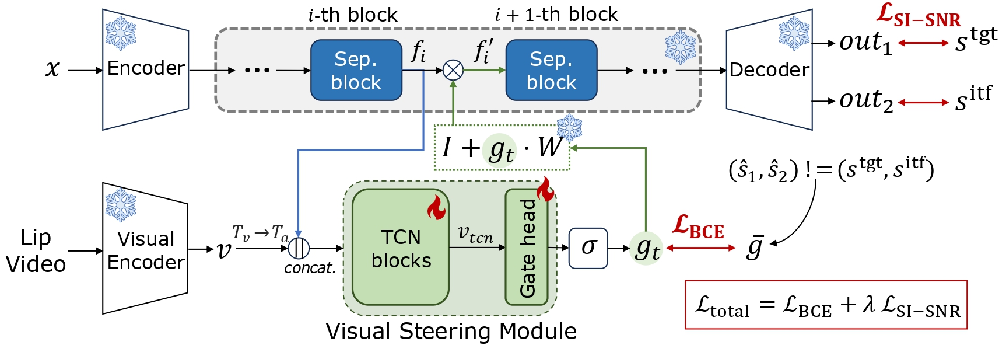

<div align="center">

# Plug-and-Steer: Decoupling Separation and Selection in Audio-Visual Target Speaker Extraction 


**Interspeech 2026** 

Doyeop Kwak\*, [Suyeon Lee](https://leesyy.github.io/)\*, and [Joon Son Chung](https://mm.kaist.ac.kr/joon/)

Multimodal AI Lab, KAIST

[](https://arxiv.org/abs/2603.19697)
[](https://plugandsteer.github.io/)


</div>

> A simple framework for adapting pre-trained speech separation models to audio-visual target speaker extraction.

---

## Method


<div align="center">
  
</div>

<p align="center"><em>Training the visual steering module. Everything marked
❄️ is frozen; only the Visual Steering Module (🔥) is trained.</em></p>

A frozen audio-only separation backbone does the separating; the visual stream
only *selects*. Selection happens through a **Latent Steering Matrix (LSM)** — a
single `C × C` linear map applied as a residual inside one separator block:

```
f' = (I + g · W) f
```

`g = 1` swaps the output channels, `g = 0` leaves them alone. A lightweight
visual module predicts `g` from lip motion, which routes the target speaker to a
fixed output channel without retraining the backbone.

---

## Setup

**1. Clone the repository**

```bash
git clone https://github.com/leesyy/Plug-and-Steer.git
cd Plug-and-Steer
```

**2. Create the conda environment**

```bash
conda create -n plugandsteer python=3.10
conda activate plugandsteer
pip install -r requirements.txt
```

## Prepare Datasets

Prepare **Libri2Mix** and **LRS2-2mix** manifests under `data/`.

### Libri2Mix

1. Download the source data: [LibriSpeech](https://www.openslr.org/12) and [WHAM!](http://wham.whisper.ai/)
2. Follow the steps in the [LibriMix repository](https://github.com/JorisCos/LibriMix).
3. Create the manifest files (`.scp`):

```bash
python data/librimix/create_scp.py --data_path LIBRI2MIX_DIR
```

### LRS2-2mix

1. Download the LRS2 data to `LRS2_SRC_DIR`.
   - Source: [LRS2](https://www.robots.ox.ac.uk/~vgg/data/lip_reading/lrs2.html)
   - Mix metadata at `data/lrs2_2mix/mixture_data_list_2mix.csv` — we follow the
     [ClearerVoice configuration](https://github.com/modelscope/ClearerVoice-Studio/blob/main/train/target_speaker_extraction/data/LRS2/mixture_data_list_2mix.csv).

2. Preprocess the audio into `LRS2_2MIX_DIR` and create the manifest files (`.scp`):

```bash
python data/lrs2_2mix/mix_and_save.py  --lrs2_src_dir LRS2_SRC_DIR --lrs2_2mix_dir LRS2_2MIX_DIR
python data/lrs2_2mix/create_scp_av.py --lrs2_src_dir LRS2_SRC_DIR --lrs2_2mix_dir LRS2_2MIX_DIR
```

## Checkpoints

**Ours**

- **Best AV-TSE checkpoint** — LSM on MossFormer2 (Tab. 2): [Link](https://drive.google.com/drive/folders/109ZuVFPuMRy7ifiWqk-3Gze2gErwbilU?usp=sharing)

**Pretrained backbones** (via ClearerVoice-Studio and Hugging Face)

- [AOSS models](https://huggingface.co/alibabasglab/MossFormer2_SS_16K)
- [AV-TSE models trained on LRS2-2mix](https://github.com/modelscope/ClearerVoice-Studio/tree/main/train/target_speaker_extraction#non-causal-offline-lrs2-mix-benchmark)

---

## Training

```bash
conda activate plugandsteer

# each run script is generated from its config and names its own tag
# stage 3 needs the LSM checkpoint first — see Three stages below
bash run_scripts/mossformer2/lrs2/av_swap/layer23.sh

# or directly
CUDA_VISIBLE_DEVICES=0,1 python train.py \
  --config ./configs/mossformer2/lrs2/av_swap/layer23.yaml \
  --tag mossformer2-lrs2-av_swap-layer23
```

The tag is just the config's path with hyphens between the directory levels, so
a config and its run script share one id
— see [One id, two places](docs/TRAIN.md#one-id-two-places).

Results land in `exps/<tag>/`: `ckpt/best.pt`, the last few numbered checkpoints,
TensorBoard events and a copy of the resolved config.


### Three stages

```bash
bash run_scripts/mossformer2/lrs2/ao_pt/base.sh            # 1. audio-only backbone
bash run_scripts/mossformer2/lrs2/swap_matrix/layer23.sh   # 2. LSM (~10k steps)
bash run_scripts/mossformer2/lrs2/av_swap/layer23.sh       # 3. steering (~100k steps)
```

Stage 2 loads the audio-only backbone and stage 3 loads the LSM, both through
`model.config.ckpt_path`. Those files are not in this release; point each path
at the `exps/<tag>/ckpt/best.pt` you just trained. What each stage trains, and
every config field it reads, is in [`docs/TRAIN.md`](docs/TRAIN.md).

## Evaluate and decode

```bash
# SI-SNR / SI-SNRi on the test set (optional: PESQ, DNSMOS, NISQA; see --metrics option)
python tools/evaluate.py  --exp_dir ./exps/mossformer2-lrs2-av_swap-layer23 --gpu_id 0

# write separated audio (default: <exp_dir>/inferences/)
python tools/inference.py --exp_dir ./exps/mossformer2-lrs2-av_swap-layer23 --gpu_id 0
```

`--exp_dir` is the checkpoint folder itself (`config.yaml` + `ckpt/`), so a
checkpoint downloaded outside `exps/` works the same way.


## Citation

```bibtex
@inproceedings{kwak2026plugandsteer,
  title     = {Plug-and-Steer: Decoupling Separation and Selection in
               Audio-Visual Target Speaker Extraction},
  author    = {Kwak, Doyeop and Lee, Suyeon and Chung, Joon Son},
  booktitle = {Proc. Interspeech},
  year      = {2026}
}
```
